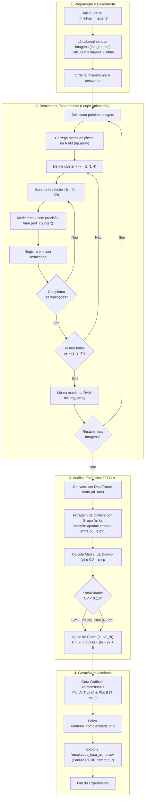

# Documentação Técnica e Análise Detalhada: `experimentador.py`

> **Disciplina:** Engenharia de Programas — UNEB  
> **Objetivo do Script:** Calibração empírica de desempenho, validação estatística de medições (Protocolo F.O.C.A.) e modelagem matemática da complexidade computacional para segmentação de imagens (K-Means).

---

## 1. Visão Geral do Sistema

O arquivo [`experimentador.py`](file:///home/caiyo/Uneb/EP/Engenharia-de-Programas/segunda_unidade/experimentador.py) implementa um **arcabouço de testes empíricos de desempenho** (*benchmarking harness*).

Em vez de se basear apenas em análise assintótica puramente teórica ($\mathcal{O}$ grande) ou em cronometragens pontuais ingênuas (que sofrem com ruídos de sistema operacional, cache e *garbage collection*), o script segue uma abordagem científica rigorosa:

1. **Variação Controlada de Entradas:** Avalia o tempo em função de duas variáveis independentes:
   - $n$: número de pixels da imagem ($largura \times altura$).
   - $k$: número de centróides / agrupamentos do K-Means.
2. **Eficiência no Uso de Memória (Gestão de RAM):** Carregamento preguiçoso (*lazy loading*) e ordenação prévia por tamanho para evitar estouro de memória (*Out of Memory - OOM*).
3. **Tratamento Estatístico (Protocolo F.O.C.A.):** Coleta $R = 30$ repetições por combinação, remove *outliers* via percentis (corte interpercentil $5\% - 95\%$) e valida a estabilidade das medições exigindo um Coeficiente de Variação ($CV$) inferior a $15\%$.
4. **Regressão / Ajuste de Curvas (*Curve Fitting*):** Usa o algoritmo de Levenberg-Marquardt (`scipy.optimize.curve_fit`) para deduzir uma equação analítica do tempo:
   $$T(n, k) = \alpha(n \cdot k) + \beta n + \gamma k + \delta$$
5. **Geração de Evidências:** Exporta gráficos comparativos (`relatorio_complexidade.png`) e tabela de dados em padrão brasileiro (`resultados_foca_aluno.csv`).

---

## 2. Diagrama de Fluxo do Pipeline



---

## 3. Análise Detalhada dos Blocos de Código

### Seção 1: Função de Segmentação (Integrada com KMeansSegmentation)
*Trecho:* Linhas 9 a 30

```python
import sys
import importlib

sys.path.append(os.path.dirname(os.path.abspath(__file__)))
KMeansSegmentation = importlib.import_module("k-means").KMeansSegmentation

_kmeans_segmenter = KMeansSegmentation()

def segmenta_imagem(imagem_array, k):
    return _kmeans_segmenter.find_clusters(imagem_array, cluster_numbers=k, max_iter=20, verbose=False)
```

* **Função e Propósito:** A função mock anterior foi substituída pela instância do algoritmo real de segmentação [KMeansSegmentation](file:///home/caiyo/Uneb/EP/Engenharia-de-Programas/segunda_unidade/k-means.py#L10).
* **Parâmetro `verbose=False`:** Desativa a impressão de logs no terminal durante as 30 repetições de cada cluster, evitando que a latência de I/O contamine o tempo medido por `time.perf_counter()`.
* **Retorno da Imagem Segmentada:** Retorna uma matriz `(n, m, 3)` do tipo `np.uint8` pronta para ser exibida via `plt.imshow(seg_img)` na primeira repetição ($r=0$).

---

### Seção 2: Descoberta e Ordenação Ligeira (Prevenção de Esgotamento de Memória)
*Trecho:* Linhas 24 a 49

```python
img_dir = "./minhas_imagens"
k_list = [2, 3, 4]
R = 30 # Número de repetições por combinação
```

* **Leitura Preguiçosa (*Lazy Metadata Scan*):**
  ```python
  with Image.open(filepath) as img:
      w, h = img.size
      n = w * h
      arquivos_n.append({'arquivo': filename, 'caminho': filepath, 'n': n})
  ```
  O método `Image.open()` do Pillow apenas analisa o cabeçalho do arquivo (PNG, JPEG, etc.), decodificando as dimensões sem alocar os milhões de bytes da matriz de pixels na memória.
* **Ordenação por Tamanho Crescente:**
  ```python
  arquivos_n = sorted(arquivos_n, key=lambda x: x['n'])
  ```
  Organizar do menor $n$ para o maior traz vantagens técnicas decisivas:
  1. **Monotonicidade no Monitoramento:** O experimentador consegue verificar imediatamente se os tempos das imagens menores estão estáveis antes de aguardar o processamento demorado das imagens de alta resolução.
  2. **Aquecimento Controlado (*Warm-up*):** O interpretador e a CPU aquecem suas caches com cargas de trabalho graduais.

---

### Seção 3: Execução sob Demanda e Cronometragem
*Trecho:* Linhas 51 a 89

```python
for item in arquivos_n:
    # Carrega a imagem real para a RAM apenas no momento de usar
    with Image.open(filepath) as img:
        img_array = np.array(img)
    
    for k in k_list:
        for r in range(R):
            t0 = time.perf_counter()
            seg_img = segmenta_imagem(img_array, k)
            t1 = time.perf_counter()
            ...
            resultados.append({
                'arquivo': nome_arquivo,
                'n': n, 
                'k': k, 
                'repeticao': r, 
                'tempo': (t1 - t0)
            })
            
    del img_array
```

* **Carregamento sob Demanda:** A matriz NumPy (`np.array(img)`) só é criada dentro do loop daquela imagem específica e descartada logo em seguida com `del img_array`. Isso impede que o acúmulo de imagens na memória dispare o *Garbage Collector* de forma intempestiva durante a tomada de tempos.
* **Precisão do Temporizador:** Utiliza `time.perf_counter()`, que acessa o relógio de alta resolução da CPU (invariante a ajustes manuais ou por NTP no relógio de parede do S.O.).
* **Amostragem Estatística ($R = 30$):** O valor de $30$ repetições é o padrão clássico baseado no **Teorema Central do Limite**, permitindo inferências estatísticas paramétricas válidas.

---

### Seção 4: Pré-processamento e Validação Estatística (Protocolo F.O.C.A.)
*Trecho:* Linhas 91 a 115

O script aplica filtros e métricas de controle de qualidade para garantir medições científicas confiáveis:

#### A. Filtragem de Outliers por Corte Interpercentil (5% e 95%)
```python
p05 = group['tempo'].quantile(0.05)
p95 = group['tempo'].quantile(0.95)
valid_mask = (group['tempo'] >= p05) & (group['tempo'] <= p95)
```
- **Por que é necessário:** Em sistemas operacionais de propósito geral (Linux/Windows), tarefas concorrentes, interrupções de rede, chaveamento de contexto (*context switch*) e *swapping* causam picos aleatórios de latência.
- O corte dos percentis 5% e 95% descarta os tempos anormalmente rápidos (efeitos espúrios de cache) e anormalmente lentos (interrupções externas).

#### B. Validação da Estabilidade via Coeficiente de Variação (CV)
```python
resumo['CV'] = resumo['desvio'] / resumo['tempo_medio']
resumo['estavel_CV_menor_15'] = resumo['CV'] < 0.15
```
- **Fórmula:**
  $$CV = \frac{\sigma}{\mu}$$
  Onde $\sigma$ é o desvio padrão amostral e $\mu$ é a média do tempo filtrado.
- **Critério de Aceitação:** Se $CV < 0.15$ ($15\%$), o experimento é considerado estável. Se for superior, indica que o ambiente de medição estava com muito ruído externo e os dados não são representativos do custo algorítmico intrínseco.

---

### Seção 5: Modelagem Não-Linear e Ajuste de Curvas (*Curve Fitting*)
*Trecho:* Linhas 117 a 129

```python
def model_n_k(X, alpha, beta, gamma, delta):
    n, k = X
    return alpha * (n * k) + beta * n + gamma * k + delta

X_data = np.vstack((resumo['n'], resumo['k']))
y_data = resumo['tempo_medio']

popt, _ = curve_fit(model_n_k, X_data, y_data, p0=[1e-6, 1e-6, 1e-6, 0.01], maxfev=10000)
resumo['tempo_predito'] = model_n_k(X_data, *popt)
```

* **Interpretação Física dos Parâmetros do Modelo:**
  1. $\alpha \cdot (n \cdot k)$: Custo assintótico dominante. No K-Means, cada iteração calcula a distância euclidiana de $n$ pixels para $k$ centros. O coeficiente $\alpha$ quantifica o tempo médio por operação básica de cálculo de distância.
  2. $\beta \cdot n$: Custos proporcionais estritamente ao tamanho da imagem (leitura de canais RGB, reorganização de matrizes/faixas, atribuição final).
  3. $\gamma \cdot k$: Custos proporcionais a $k$ (inicialização e recálculo das médias dos centróides).
  4. $\delta$: Constante de overhead fixo (tempo de chamada de função, alocação de objetos em memória).
* **Mecanismo:** A função `curve_fit` minimiza a soma dos quadrados dos resíduos entre os dados empíricos observados e os valores preditos pelo modelo:
  $$\min_{\alpha, \beta, \gamma, \delta} \sum \left( y_i - \text{model\_n\_k}(X_i) \right)^2$$

---

### Seção 6: Plotagens Bidimensionais
*Trecho:* Linhas 131 a 174

Gera uma figura dividida em dois eixos ortogonais para permitir uma visualização multidimensional completa do comportamento do algoritmo:

| Painel | Eixo X | Eixo Y | Objetivo |
| :--- | :--- | :--- | :--- |
| **Plot A (Esquerda)** | Número de Pixels ($n$) | Tempo Médio (s) | Mostra como o algoritmo escala com resoluções maiores para cada valor fixo de $k$. As linhas tracejadas exibem o modelo teórico ajustado. |
| **Plot B (Direita)** | Número de Clusters ($k$) | Tempo Médio (s) | Mostra a sensibilidade do algoritmo à complexidade da segmentação ($k \in \{2, 3, 4\}$) para diferentes resoluções de imagem. |

A figura resultante é exportada em alta fidelidade (`dpi=300`) no arquivo `relatorio_complexidade.png`.

---

### Seção 7: Exportação de Resultados
*Trecho:* Linhas 176 a 186

```python
arquivo_csv = 'resultados_foca_aluno.csv'
resumo.to_csv(arquivo_csv, index=False, float_format='%.6f', sep=';', decimal=',')
```

* **Localização PT-BR:** Salva com separador ponto-e-vírgula (`;`) e vírgula decimal (`,`). Isso permite que os dados sejam importados diretamente em softwares de planilha (Excel, LibreOffice Calc) configurados no padrão brasileiro sem que números decimais sejam corrompidos em datas ou textos.

---

## 4. Diagnóstico de Pendências e Ajustes
- [x] **Integração com o K-Means Real:** Concluída em `k-means.py` e conectada em `experimentador.py`.
- [x] **Correção do `plt.imshow`:** A função `segmenta_imagem` agora retorna a matriz segmentada `np.uint8`.
- [ ] **Configuração do Diretório de Imagens:** Ajustar `img_dir` na linha 35 de `experimentador.py` para apontar para a pasta contendo as imagens reais de teste (ex.: `"../programando_k-means/img"`).

---

## 5. Resumo Sintético dos Parâmetros

| Parâmetro | Valor Configurado | Significado |
| :--- | :--- | :--- |
| `k_list` | `[2, 3, 4]` | Quantidade de grupos/clusters testados |
| `R` | `30` | Repetições por par $(n, k)$ para garantir validade amostral |
| `p05` / `p95` | Percentis 5% e 95% | Faixa de corte de *outliers* do protocolo F.O.C.A. |
| Limite de $CV$ | `0.15` (15%) | Limiar de aceitação para homologação de estabilidade |
| Saídas | `.png` e `.csv` | `relatorio_complexidade.png` e `resultados_foca_aluno.csv` |
